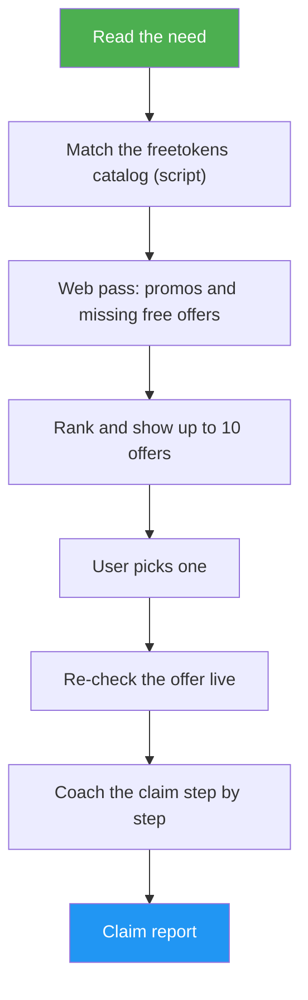

<!--
  DO NOT READ THIS FILE — This README.md is for human catalog browsing only.
  It ships inside the .skill package but is NEVER auto-loaded into agent context.
  The runtime loader only reads SKILL.md + references/ + scripts/ + agents/ when the skill triggers.
  If you're an AI agent, read the SKILL.md file instead for skill instructions.
-->

# Free AI Finder

> Tell it what you want to build with — a voice API, an image generator, GPU time — and get up to 10 free or discounted offers, then a step-by-step coach while you claim one.

## Highlights

- Starts from the freetokens catalog (240+ curated offers, re-checked daily) and fills gaps with web finds confirmed on the provider's own site
- Labels every row Free or Promo, with card requirement, claim-by date, and last-checked date
- Re-checks the offer you pick live before coaching you through it
- Coaches one claim step at a time and troubleshoots common snags (missing emails, phone checks, region locks)
- Never asks for passwords, card numbers, one-time codes, or API keys; never signs up or pays for you

## When to Use

| Say this... | Skill will... |
| --- | --- |
| "I need a free text-to-speech API, no credit card" | List up to 10 matching offers with how to claim each |
| "Find free or discounted image generation APIs" | Mix free offers with confirmed promotions, each with its price after the promo |
| "Help me claim the AssemblyAI free credits" | Re-check that offer live, then walk you through claiming it step by step |
| "Any free GPU credits for fine-tuning? I'm a student" | Include student programs alongside open offers |

Not for: adding offers to the freetokens catalog, re-checking the catalog, or help integrating an API into your code.

## How It Works



## Usage

```
/free-ai-finder free speech-to-text API for a podcast app
```

Or just ask in plain words ("what free voice APIs can I get?"); the skill triggers on its own.

## Resources

| Path | Description |
| --- | --- |
| `scripts/catalog_match.py` | Reads the live catalog (or a local freetokens checkout), ranks offers for the need, and attaches claim steps, deadline, source, and card state as JSON |
| `agents/web-scout.md` | Worker prompt for the web pass: find promotions and missing free offers, confirm each on an official page |
| `references/trust-rules.md` | What counts as an official source, what is never listed, Free vs Promo, card state, catalog labels |
| `references/claim-coach.md` | The claim walkthrough: plan, one step per message, troubleshooting, card disclosure, secret-safe test call |
| `references/output-format.md` | Expected output for the offer list, the re-check, and the claim report |
| `references/web-tools.md` | Read-only search and fetch routes and URL safety rules |

## Output

A ranked table of up to 10 offers (Free or Promo, card requirement, claim-by date, last checked), how to get each with its source link, what was not checked, and a prompt to pick one. After you pick, a live re-check and a one-step-at-a-time claim walkthrough that ends with a claim report (claimed, stopped, or blocked) and the dates to remember.
